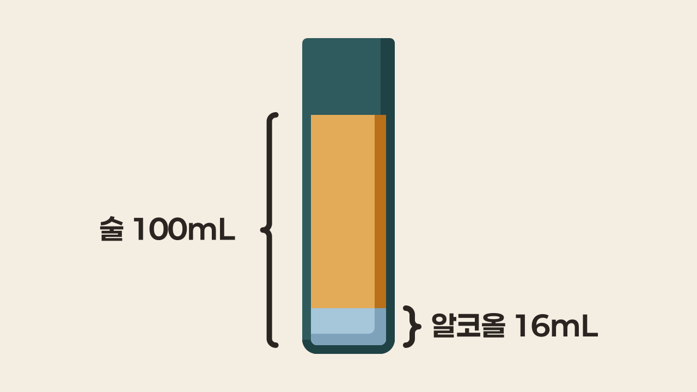
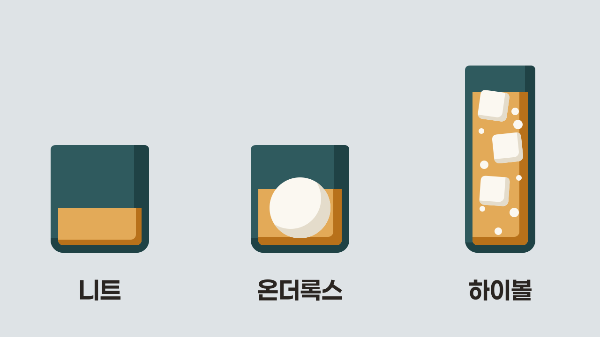

술자리에서 "바디감이 묵직하네", "하이볼로 주세요" 같은 말을 듣고 고개만 끄덕인 적 있으시죠? 알고 보면 어렵지 않은 말이에요. 바디감은 술이 입안에서 주는 무게감이고, 하이볼은 술에 소다수 같은 음료를 섞어 얼음과 함께 마시는 방법입니다.

## 도수: 술 전체 부피에서 알코올이 차지하는 비율

"이거 세요?"라는 질문에 답하는 숫자가 <strong>알코올 도수(ABV)</strong>입니다. 한국 주세법은 도수를 15°C에서 술 전체 부피 100 가운데 알코올이 차지하는 부피로 정해요. 그래서 도수 16%인 소주는 술 100mL에 알코올이 16mL 들어 있고, 360mL 병이든 한 잔이든 도수는 똑같아요.

<Callout variant="caution">

도수에서 말하는 알코올은 <strong>에탄올(에틸알코올)</strong>입니다. 참고로 알코올 종류 중에는 **메탄올**이란 것도 있는데, 이건 마시면 실명이나 사망까지 일으킬 수 있어요.

</Callout>

도수가 비율이라는 점을 기억하면 헷갈릴 일이 줄어요. 도수는 전체 가운데 알코올의 몫이라서 100%를 넘을 수 없습니다. 그리고 한국 법은 도수 1% 이상인 음료부터 술로 봐요.

익숙한 술의 대략적인 도수를 나란히 놓아 볼까요?

| 술 | 도수 |
| --- | --- |
| 맥주 | 약 4~5% |
| 막걸리 | 약 6% |
| 와인 | 8.5% 이상 |
| 사케 | 약 15~16% |
| 소주 | 약 16~20% |
| 위스키 | 40% 이상 |

<Callout title="미국 위스키 라벨의 프루프">

미국 위스키 라벨에는 도수 옆에 프루프(proof)가 적혀 있기도 해요. 미국 규정에서 **프루프**는 **도수**의 2배라서, 80 프루프는 도수 40%입니다. 그래서 프루프는 100을 넘을 수 있어요. 미국 규정은 위스키를 40%(80 프루프) 이상으로 병에 담도록 정합니다.

</Callout>

## 논알코올과 무알코올: 알코올 1% 미만 음료의 두 이름

"논알코올 맥주", "무알코올 맥주"라는 말을 들으면 둘이 같은 건지 헷갈리죠? 한국 주세법은 도수 1% 이상인 음료부터 술로 보기 때문에, 둘 다 법으로는 술이 아니에요. 그리고 흔히 논알코올이라고 부르는 음료는 식약처 기준으로 비알코올에 해당해서, 결국 둘의 차이는 들어 있는 알코올의 양입니다.

식약처 수입식품 검사 기준은 알코올이 0.001% 미만이면 **무알코올**, 0.001% 이상 1% 미만이면 **비알코올**로 판단해요. 식약처 자료도 1% 미만 음료의 영문 표기를 '논 알코올릭(Non Alcohol)'으로 보여 줍니다. 반면 '논알코올'이라는 말 자체는 표준국어대사전에 없어요.

헷갈리기 쉬운 점이 하나 있어요. 영어 nonalcoholic 은 사전에서 "알코올을 담고 있지 않은"이라는 뜻입니다. 그런데 논알코올이라고 부르는 비알코올 음료에는 1% 미만이라도 알코올이 들어 있어요. 그러니 이름만 보고 알코올이 전혀 없다고 여기면 틀릴 수 있습니다.

## 니트·온더록스·하이볼: 얼음과 섞는 음료로 나뉘는 마시는 법

바에서 "위스키는 어떻게 드릴까요?"라는 질문을 받으면 당황스럽죠? 위스키 같은 증류주를 마시는 세 방식은 얼음을 넣는지, 다른 음료를 섞는지로 갈려요.

| 마시는 법 | 얼음 | 섞는 음료 |
| --- | --- | --- |
| 니트(neat) | X | X |
| 온더록스(on the rocks) | O | X |
| 하이볼(highball) | O | 소다수, 진저에일, 물 등 |

- **니트**: 물이나 탄산음료를 섞지 않은 술을 그대로 마시는 방식입니다. 미쉐린 가이드는 증류주 한 가지 2온스(약 60mL)를 잔에 따라 홀짝이는 것으로 설명해요.
- **온더록스**: 얼음 위에 술만 붓는 방식이에요. 여기서 rocks 는 얼음 조각을 가리킵니다.
- **하이볼**: 증류주에 소다수나 진저에일, 물 등을 섞어 얼음과 함께 키 큰 잔에 내는 음료예요.

<Callout title="스트레이트와 스트레이트 업의 차이">

**스트레이트**(straight)는 니트와 같은 뜻이에요. 헷갈리는 쪽은 **스트레이트 업**(straight up)으로, 상온 증류주에서는 니트와 같은 뜻이지만 차갑게 마시는 칵테일에서는 업(up)을 뜻하기도 합니다. 업은 술을 얼음과 함께 젓거나 흔들어 차게 한 뒤, 얼음은 걸러 내고 잔에 내는 방식이에요.

</Callout>

## 드라이: 남은 당이 적어 달지 않은 맛

"이 와인 드라이하네"라는 말을 들으면 입이 마른다는 뜻인지 궁금해지죠? 술에서 <strong>드라이(dry)</strong>의 기본 뜻은 "달지 않다"입니다. 술이 달지 않은 까닭은 발효가 끝난 뒤 남은 당, 곧 잔당이 적어서예요.

헷갈리기 쉬운 점이 하나 있어요. 레드 와인을 마시고 입안이 마르는 느낌은 **단맛**이 아니라 **떫은맛**에서 옵니다. 포도 껍질과 씨에서 온 타닌(tannin)이 침 속 단백질과 붙으면서, 입안을 매끄럽게 해 주는 단백질이 줄어들기 때문이에요. 그런데 일부 사람들은 이렇게 떫은 와인이나 도수가 13%를 넘는 와인도 드라이하다고 부르기도 합니다. 그러니 와인이 드라이하다는 말을 들으면, **달지 않다**는 뜻인지 **떫다**는 뜻인지 앞뒤 맥락을 보고 들어 보세요.

## 바디감: 입안에서 느끼는 무게감

물을 마실 때와 우유를 마실 때 입안 느낌이 다르죠? <strong>바디(body)</strong>는 이처럼 술이 입안에서 주는 무게감을 가리켜요. 옥스퍼드 대학교 출판부에서 펴낸 맥주 용어 백과사전에 따르면, 이 감각은 마실 때 느끼는 무게감과 흐름에 대한 저항감입니다.

맥주에서는 덱스트린(효모가 발효하지 못하고 남은 당 사슬)이 많이 남을수록 바디가 커져요. 덱스트린은 그 자체로는 맛이 없습니다. 사케는 알코올, 당, 산, 아미노산이 많을수록 진하고 적을수록 가볍습니다. 와인에서는 한 실험에서 산이 높을수록 바디를 가볍게 느끼는 경향이 나왔어요.

## 피니시: 삼킨 뒤 입에 남는 맛

"피니시가 길다"는 말을 들으면 무엇이 길다는 건지 궁금해지죠? <strong>피니시(finish)</strong>는 술을 삼킨 뒤 입에 남는 맛을 말해요. 맥주와 커피 평가에서는 같은 감각을 애프터테이스트(aftertaste)라고 부릅니다. 이렇게 남는 맛은 술을 평가할 때 중요한 기준이라, 피니시가 '짧다'고 하면 아쉽다는 뜻이에요.