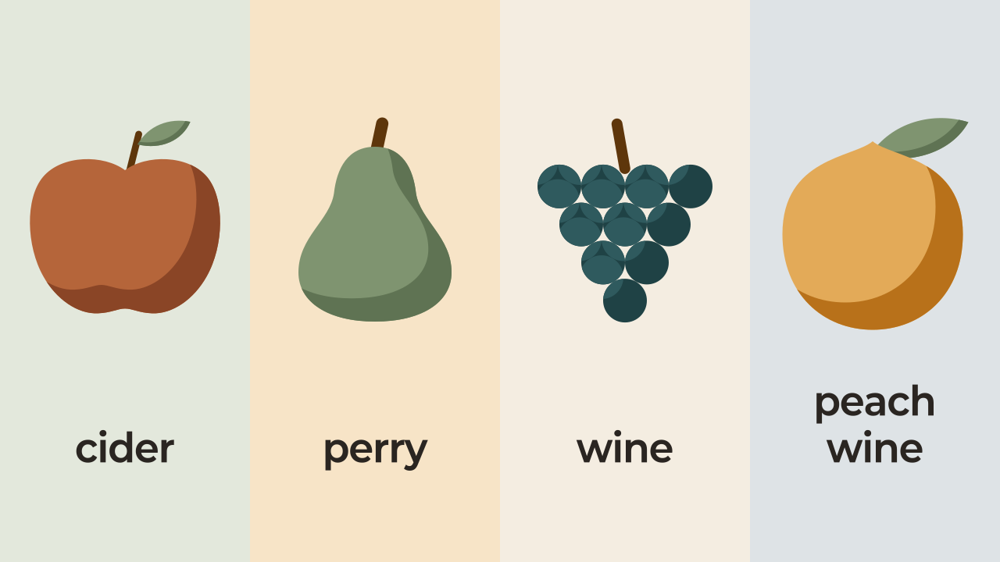

사이다 하면 칠성사이다부터 떠오르는데, 영국·프랑스 같은 유럽에서 사이다(cider)를 시키면 술이 나와요. 그 사이다는 사과즙을 발효해 만든 술입니다. 국내에서 파는 제품은 도수가 맥주와 비슷하고, 맛은 단맛과 신맛, 떫은맛의 균형에 따라 갈려요.

## 같은 이름, 다른 음료: 한국 사이다와 외국 사이다

처음 들으면 헷갈리는 게 당연해요. 한국에서 사이다는 설탕물에 탄산나트륨과 향료를 섞은 청량음료를 가리킵니다. 그런데 영국에서 사이다는 사과즙이나 배즙을 발효한 술을 뜻해요.

그렇다면 왜 이름이 같을까요? 일본에서는 메이지 시대 초기부터 사과 계열 향료를 넣은 탄산음료를 "샴페인 사이다"라고 불렀어요. 한국의 첫 사이다도 1905년 일본인이 인천에 세운 공장에서 나왔습니다. 그리고 지금도 한국에서는 탄산음료를 사이다라고 불러요.

나라마다 이름도 조금씩 달라서, 프랑스에서는 시드르(cidre), 스페인에서는 시드라(sidra)라고 불러요. 메뉴판에서 이 단어들을 보면 사과 술이라고 생각하면 됩니다.

<Callout title="미국의 스위트 사이다와 하드 사이다">

미국에서는 발효하지 않은 사과즙을 스위트 사이다(sweet cider), 발효한 술을 하드 사이다(hard cider)라고 나눠 부릅니다. 미국 메뉴판에서는 하드 사이다라고 적힌 것이 술이에요.

</Callout>

## 사과 술: 와인과 같은 원리로 만드는 술

그럼 사이다 술은 정확히 뭘까요? 사이다는 사과즙에 원래 들어 있는 당을 효모(당을 알코올로 바꾸는 미생물)가 알코올로 바꿔 만든 술입니다. 와인도 포도즙의 당을 효모가 바로 발효해 만들기 때문에, 사이다는 원료만 다른 와인의 사촌이라 할 만해요. 실제로 미국 주류 당국은 사이다를 와인의 한 종류로 분류합니다.

재밌는 점은 과일을 바꾸면 이름도 바뀐다는 거예요. 사과 대신 배로 만든 술은 페리(perry)라고 부릅니다. 그런데 미국 법에서 포도를 뺀 과일 술 가운데 이렇게 고유한 이름이 있는 것은 사과와 배뿐이에요. 나머지는 복숭아 와인(peach wine)처럼 과일 이름 뒤에 와인을 붙여 부릅니다.

## 도수: 맥주와 비슷한 술

센 술인지 궁금하셨죠? 국내 제조사와 수입사가 표시한 330mL 사이다의 알코올 도수(ABV)는 4.3~5.9%예요. 우리가 아는 술과 나란히 놓으면 위치가 한눈에 보입니다. 아래 도수는 제조사·수입사가 제품에 표시한 값이에요(막걸리는 2011~2012년 자료).

| 술 | 원료 | 도수 | 기준 제품 |
| --- | --- | --- | --- |
| 사이다 | 사과 | 4.3~5.9% | 써머스비, 댄싱사이더 330mL |
| 맥주 | 보리 맥아, 홉 | 4.5~4.6% | 테라, 켈리 |
| 막걸리 | 쌀 | 6% | 대표 생막걸리(2011~2012년 자료) |
| 와인 | 포도 | 14% | 진로 레드와인 |
| 희석식 소주 | 주정(정제한 알코올)과 물 | 15.7~20.1% | 참이슬 fresh, 진로, 참이슬 오리지널 |

표처럼 사이다는 맥주와 도수가 겹치는 술이에요.

<Callout title="와인이 사이다보다 센 이유">

효모가 당을 알코올로 바꾸기 때문에, 즙에 당이 많을수록 도수가 높아집니다. 그런데 와인용 포도즙은 사이다용 사과즙보다 당이 많아서, 같은 방식으로 발효해도 와인이 더 센 술이 돼요.

</Callout>

## 맛: 단맛, 신맛, 떫은맛의 균형

그럼 무슨 맛일까요? 미국 사이다 심사 기준 단체는 사이다 맛을 단맛, 신맛, 떫은맛의 균형으로 봅니다. 첫 번째 기준은 단맛이에요. 효모가 당을 알코올로 거의 다 바꾸면 달지 않은 드라이(dry)가 되고, 당이 많이 남으면 달콤한 스위트(sweet)가 돼요.

두 번째 기준은 떫은맛이에요. 떫은맛은 혀로 느끼는 맛이 아니라 입안이 마르고 오므라드는 촉감이고, 사과 속 타닌(tannin)이 이 느낌을 냅니다. 사이다용 사과 중 비터스위트(bittersweet, 타닌이 많고 신맛이 적은 품종)가 타닌이 가장 많아요. 반대로 우리가 먹는 사과는 타닌이 가장 적습니다. 타닌은 사이다에 묵직함을 주는데, 그래서 타닌이 없는 사이다는 밋밋해져요.

신맛은 떫은맛과 함께 단맛이 물리지 않게 받쳐 줍니다. 우리가 먹는 사과로 만든 사이다는 타닌이 적고 신맛이 높아 상큼해요.

나라별 차이도 이 세 가지로 보면 쉬워요.

| 나라 | 맛의 특징 | 눈여겨볼 점 |
| --- | --- | --- |
| 영국 | 중간~강한 떫은맛과 약간의 쓴맛, 전통적으로 달지 않은 드라이 | 타닌이 많은 사이다용 사과로 만든 술 |
| 프랑스 | 중간 정도의 떫은맛, 달게 만드는 경우가 많은 편 | 노르망디 원산지 보호 사이다의 병 속 발효로 낸 탄산 |
| 스페인 | 높은 휘발산(식초 같은 시큼한 향을 내는 성분) | 전통 제품의 경우 발효에서 남은 탄산뿐 |

떫고 드라이한 쪽은 영국, 단 쪽은 프랑스, 시큼한 쪽은 스페인이에요.

<Callout title="높이 따르는 스페인식 에스칸시아르">

스페인 아스투리아스 지방에서는 스페인 사이다(시드라)를 높은 곳에서 잔으로 떨어뜨려 따릅니다. 이 따르는 법을 에스칸시아르(escanciar)라고 해요. 이렇게 따르면 탄산이 빠지며 시큼한 향이 날아가요.

</Callout>

## 고르는 법: 라벨의 단맛 표시부터

뭘 골라야 할지 막막하다면 라벨에서 단맛 표시부터 찾아보세요. 프랑스 법은 프랑스 사이다(시드르)의 단맛 표시를 네 가지로 정하고, 표시마다 도수 기준도 둡니다.

| 라벨 표기 | 단맛 | 도수 |
| --- | --- | --- |
| doux(두) | 가장 단 편 | 3% 이하 |
| demi-sec(드미섹) | 두(doux) 다음으로 단 편 | 3% 초과 |
| brut(브뤼) | 단맛이 적은 편 | 3.5% 이상 |
| extra brut(엑스트라 브뤼) | 단맛이 가장 적은 편 | 5% 이상 |

표처럼 달수록 도수가 낮아요. 효모가 당을 알코올로 덜 바꾼 만큼 더 달고 도수는 낮은 거예요.

다만 라벨에 아이스 사이다(ice cider)라고 적혀 있다면 따로 봐야 해요. 아이스 사이다는 사과나 사과즙을 얼려 당을 진하게 만든 뒤 발효해서 도수가 7~13%로 높아요. 캐나다 퀘벡 정부는 퀘벡산 아이스 사이다를 리큐르처럼 단 사이다로 설명합니다.

국산 제품 중에도 이름에 스위트(Sweet)나 드라이(Dry)를 넣어 단맛을 알려 주는 것이 있습니다. 그러니 단 음료에 익숙하다면 달콤한 두·스위트 쪽이, 달지 않은 술을 좋아한다면 브뤼·드라이 쪽이 입에 맞을 거예요.
