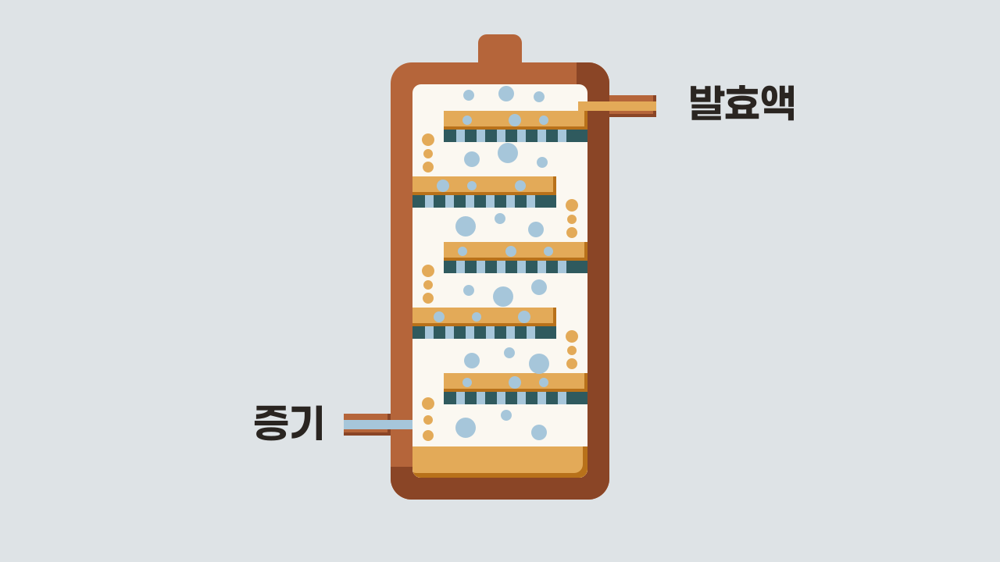
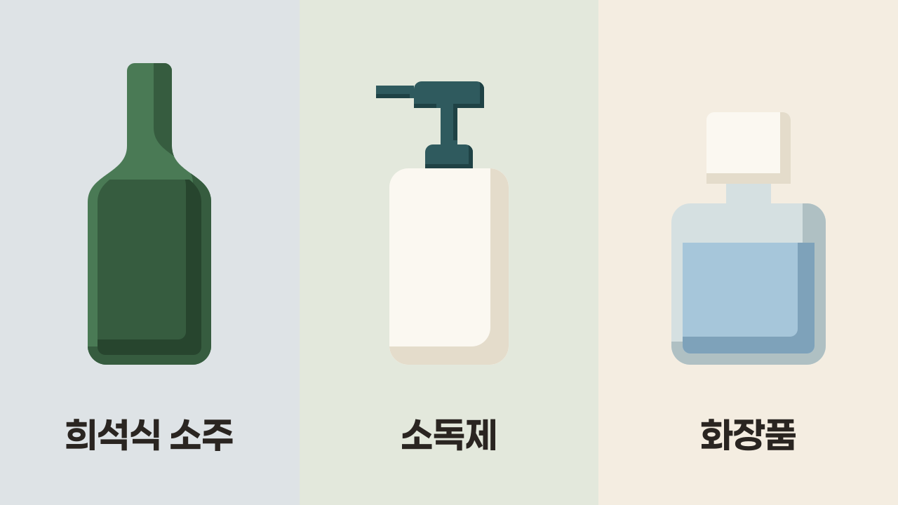

희석식 소주의 주원료가 "주정" 이라는 말, 들어 보셨나요? 주정은 녹말이나 당분이 든 원료를 발효해 증류한 에탄올로, 맛과 향이 거의 없습니다. 이 주정은 소주 같은 술은 물론 소독제와 화장품에도 두루 쓰여요.

## 주정: 맛과 향을 걷어 낸 에탄올

**주정**은 에탄올을 말합니다. 맥주나 와인에 들어 있는 알코올, 바로 그거예요. 이 에탄올을 얻는 원료는 두 갈래로 나뉩니다.

- **녹말 원료**: 쌀, 보리, 고구마, 타피오카처럼 녹말이 많은 작물이에요. 우리나라는 이쪽을 씁니다.
- **당분 원료**: 사탕수수, 사탕무처럼 당분이 많은 작물이에요. 사탕수수가 많이 나는 나라에서 씁니다.

주정에 맛과 향이 거의 없습니다. 원료를 발효한 뒤 <strong>연속식 증류</strong>로 뽑아내기 때문이에요. 연속식 증류기는 탑에 발효액을 멈추지 않고 넣으면서 알코올을 뽑아내는 장치입니다. 탑 안은 구멍 뚫린 금속판(단) 여러 장으로 칸이 나뉘고, 칸마다 증기와 액체가 맞닿으며 증기에서 물과 향 성분이 걸러져요. 그래서 단을 많이 둘수록 알코올은 진해지고 향 성분은 줄어듭니다.

식품의약품안전처의 식품 규격(식품공전)은 에탄올이 <strong>95% 이상</strong> 들어 있고 잡맛과 잡내가 없는 것을 주정으로 봅니다. 주정을 파는 대한주정판매도 주정을 "무색, 무취, 무미" 의 알코올로 소개해요.

<Callout title="주정과 위스키의 차이">

주정과 위스키는 둘 다 발효한 원료를 증류해 얻지만, 도수와 향이 다릅니다. 주정은 도수 <strong>95% 이상</strong>으로 향을 거의 걷어 낸 알코올입니다. 반면 위스키는 증류할 때 <strong>95% 미만</strong>(미국 기준, 스카치는 94.8% 미만)으로 뽑아 원료의 향을 남겨요.

</Callout>

## 주정의 활용: 소주부터 화장품까지

- **희석식 소주**: 주정을 물로 묽혀 만들어요.
- **맥주, 위스키**: 만들 때 주정을 섞을 수 있어요.
- **소독제**: 의료기기 등을 소독하는 제품의 원료로 써요.
- **화장품**: 화장수, 향수, 샴푸를 만들 때 원료를 녹이는 데 써요.

대한주정판매는 주정이 소주 같은 술을 만드는 데 가장 많이 쓰인다고 밝혀요.

