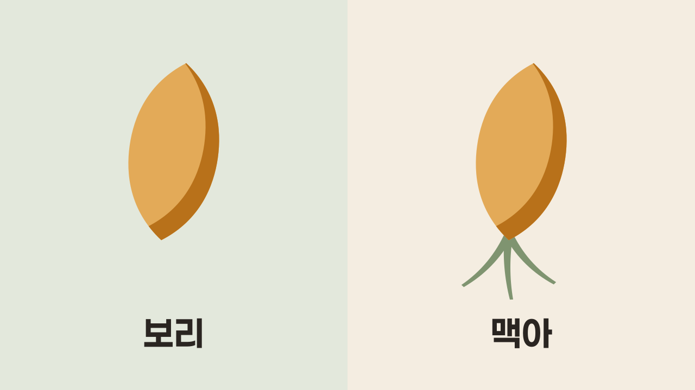

## 보리·홉·물만 쓰라는 1516년 규정

<strong>맥주 순수령(Reinheitsgebot)</strong>은 1516년 독일 바이에른의 두 공작이 정한 맥주 원료 규정입니다. 원문은 "**어떤 맥주에도 보리, 홉, 물 외에는 아무것도 넣어 쓰지 말라**"고 적었어요(원문에 적힌 것은 싹을 틔운 보리인 맥아(malt)가 아니라 그냥 보리예요).

왜 만들었는지는 정확히 밝혀지지 않았어요. 맥주에 밀과 호밀을 못 쓰게 해 빵 재료로 돌리려 했다는 설, 나쁜 맥주를 막으려 했다는 설, 맥줏값을 맞추려 했다는 설이 함께 꼽힙니다.

1516년 원문에는 효모가 없습니다. 효모는 1906년 독일 제국 맥주세법이 순수령을 제국 전체로 넓히면서 원료에 들어갔어요. 이 법은 하면발효 맥주의 원료를 보리 맥아, 홉, 효모, 물로 묶었습니다.

지금은 독일의 「잠정 맥주법」 제9조가 이 규정을 이어받았어요. 하면발효 맥주는 지금도 이 네 가지만 쓸 수 있습니다. 반면 윗면발효 맥주는 밀 같은 다른 곡물의 맥아도 쓸 수 있어요.

<Callout title="윗면발효와 하면발효">

- **윗면발효**: 발효 중에 효모가 표면으로 떠오르는 발효예요.
- **하면발효**: 발효를 마친 효모가 통 바닥으로 가라앉는 발효예요.

발효 온도도 달라요. 하면발효는 대략 5~10°C의 낮은 온도에서, 윗면발효는 대략 15~24°C의 높은 온도에서 합니다.

참고로 윗면발효로 빚은 맥주를 에일, 하면발효로 빚은 맥주를 라거라고 불러요.

</Callout>

## 맥아와 홉

### 녹말을 당으로 바꾸는 맥아

<strong>맥아</strong>는 곡물에 일부러 싹을 틔운 뒤 말리고 열을 가한 것으로, 보리가 가장 알맞고 밀이나 호밀 등으로도 만듭니다. 싹을 틔우는 건 효소를 얻기 위해서예요. 이 효소가 낟알 속 녹말을 잘라, 효모가 발효할 수 있는 당으로 바꿉니다.

<Callout title="싹이 터야 효소를 얻는 이유">

보리 낟알 속 녹말은 싹이 자랄 때 쓰려고 모아 둔 양분이에요. 싹이 트기 시작하면 낟알은 이 녹말을 쓰려고 효소를 만들거나 깨웁니다.

</Callout>

빻은 맥아를 뜨거운 물에 풀면, 맥아를 말릴 때 잠들었던 아밀레이스(amylase)라는 효소가 다시 깨어나 본격적으로 일하기 시작합니다. 녹말을 당으로 바꾸는 이 효소는 다음 두 가지로 나뉘어요.

- **α-아밀레이스**: 긴 녹말 사슬의 안쪽을 끊어 조각내요.
- **β-아밀레이스**: 그 조각에서 발효할 수 있는 당인 말토스를 떼어 내요.

### 쓴맛과 함께 맥주를 지키는 홉

<strong>홉(hop)</strong>은 맥주에 쓴맛과 향을 더하는 덩굴풀의 꽃이에요. 여러해살이풀로, 맥주에는 암그루의 솔방울 모양 꽃송이만 씁니다. 꽃송이 속 노란 샘(루풀린샘)이 쓴맛을 내는 수지(끈적한 진)와 향을 내는 정유(식물의 향기 기름)를 만들어요.

그런데 굳이 쓴맛을 넣는 이유가 궁금하지 않으세요? 홉은 맥주가 덜 상하게 하는 방부제로 쓰였어요. 쓴맛을 내는 성분이 맥주를 상하게 하는 세균도 억제해서, 홉을 넣으면 쓴맛과 보존 효과가 함께 따라옵니다.
